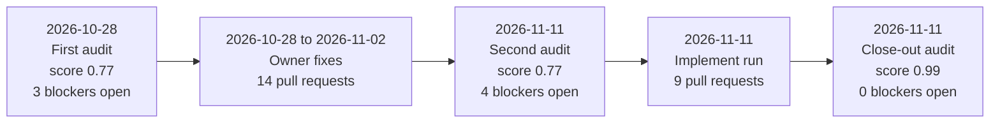

# Agentic-readiness history

This page records how the SDK became safe for AI coding agents to work in, from the first audit to the close-out
audit. In 14 days the Phase 1 score rose from 0.77 to 0.99, and the open blockers fell from 3 to 0. It is a permanent
record: add a new section for a later audit, and never rewrite an old one.

## What agentic readiness means

An AI coding agent works only with what the repository tells it. It needs one command that proves a change is
good, and rules it can find. It needs docs that match the code, and guards that stop a mistake before it lands. The framework's
audit scores 76 such checks. A **blocker** is a check that, while it fails, makes agent work unsafe.

The same guards help a new developer. Every rule an agent reads is a rule a person no longer has to ask about.

## Timeline

This diagram shows the five stages and the score after each audit.

| Date | Stage | Commit on `dev` | Score | Open blockers | Checks passing |
|---|---|---|---|---|---|
| 2026-10-28 | First audit (framework catalogue 0.2.2) | `ee2fb9e` | 0.7698 | 3 | 43 of 71 |
| 2026-11-11 | Second audit (catalogue 0.7.0) | `16c02fce8` | 0.7744 | 4 | 47 of 76 |
| 2026-11-11 | Close-out audit (catalogue 0.7.0) | `4738ce533` | 0.9925 | 0 | 74 of 76 |

The first two scores are not directly comparable: the catalogue grew from 71 to 76 checks between them, and some
checks became stricter. The second and the close-out audits use the same framework release (0.3.4) and catalogue,
so their scores compare directly.

## Stage 1: the raw state (2026-10-28)

The first audit found a working SDK with gaps that leave an agent guessing. It confirmed 24 findings and deferred 2.
The main ones:

- No local hooks and no commit-message rule, so mistakes surfaced only in CI.
- No baseline for lint debt and no coverage floor, so an agent could not tell old debt from new.
- No `docs/` folder at all: no style guide, no decision records and no architecture map.
- An `AGENTS.md` with stale lines, no single-test command and no rule against editing tests to make them pass.
- Ignore rules that missed `.env` variants and most secret file shapes.
- No CONTRIBUTING, SECURITY, CODEOWNERS, LICENSE, pull-request or issue templates.

Report: [`digital-assistant-sdk-first-audit-20261028T130422Z.md`](agentic-readiness-report/digital-assistant-sdk-first-audit-20261028T130422Z.md).

## Stage 2: owner fixes (2026-10-28 to 2026-11-02)

The maintainer acted on the first report with 14 pull requests into `dev`, plus 3 Dependabot updates and one
back-merge from `main`. Among them:

- a gitleaks secret scan in CI (#225) and its allowlist for commit ids (#229);
- merge-queue support (#226) and a Conventional Commits check on pull-request titles (#239, #240);
- an optional host-provided auth token with no client secret (#227);
- the AGPL-3.0 licence (#236), CODEOWNERS (#238) and a dependency-audit fix (#237);
- the squash-into-`dev` merge method, written down (#241, #242).

## Stage 3: second audit (2026-11-11, 07:05 to 07:21 UTC)

The second audit ran on the newer framework release. It confirmed 30 findings, 4 of them blockers, and the owner
kept all 30 for the implement run. Report:
[`digital-assistant-sdk.audit-report.20261111T072141Z.md`](agentic-readiness-report/digital-assistant-sdk.audit-report.20261111T072141Z.md).

## Stage 4: the implement run (2026-11-11)

The framework's implement recipe closed the findings one theme at a time, each theme in its own pull request through
the merge queue. Every change passed `npm run check` and CI before it merged.

| Pull request | Theme | What changed | What it gives a developer or an agent |
|---|---|---|---|
| #244 | Triage | The second report and the run's state file | Every decision is recorded and resumable |
| #245 | Secrets and env | Log-level keys in the env schema; ignore rules for every secret file shape | A future key or `.env` file cannot be committed by accident |
| #246 | Formatting | Prettier over the whole tree; lint over `test/` and `scripts/` | One consistent style; no reformat noise in reviews |
| #247 | CI, hooks, commits | lefthook hooks, commitlint, actionlint and zizmor, all in CI | Bad formatting, a leaked token or a bad commit subject is stopped locally |
| #248 | Default branch | `dev` became the default branch; Dependabot security PRs pass the checks | Clones and new pull requests start from the integration branch |
| #249 | Baselines | ESLint capped at 686 warnings; 80% line-coverage floor | Debt can only go down; a coverage drop fails the gate |
| #250 | Docs and navigation | Style guide, ADR policy and four ADRs, architecture overview, Markdown lint | New engineers find the rules, the map and the decisions |
| #251 | `AGENTS.md` | Test rule, definition of done, reach line, "How to write for people", `CLAUDE.md` pointer | Every agent tool on the team reads the same accurate rules |
| #252 | Hygiene and index | CONTRIBUTING, SECURITY, templates, rulesets as code, `.mcp.json` | Contributors know the process; agents get the code index |

The owner also turned on GitHub private vulnerability reporting on 2026-11-11.

## Stage 5: close-out audit (2026-11-11, 15:06 to 15:16 UTC)

The close-out audit ran on `dev` at `4738ce533`, with the same settings as the second audit. 74 of 76 checks pass.
The comparison with the second audit:

- 26 checks improved, and every move is explained by the run's state file, except TOOL-07, which the lefthook
  branch guard in #247 closed without a finding.
- 28 findings closed. One moved: a stale path in `AGENTS.md`, fixed in the close-out pull request.
- One finding stays open by the owner's choice: 89 of 266 exported declarations have no doc comment (NAV-05).

Report:
[`digital-assistant-sdk.audit-report.20261111T151647Z.md`](agentic-readiness-report/digital-assistant-sdk.audit-report.20261111T151647Z.md).

## Keep the gains

- Run `npm run check` before every pull request. It runs format, lint, type check and tests with the coverage floor.
- A baseline only goes down and the coverage floor only goes up. Raising either needs the maintainer.
- Update docs and decision records in the same change as the code (`AGENTS.md`, definition of done).
- Re-run the audit after a large change, and add its result to this page as a new section.

The run's decisions, skips and remaining debt are in
[`agentic-readiness/digital-assistant-sdk-agentic-readiness-STATE.md`](agentic-readiness/digital-assistant-sdk-agentic-readiness-STATE.md).
