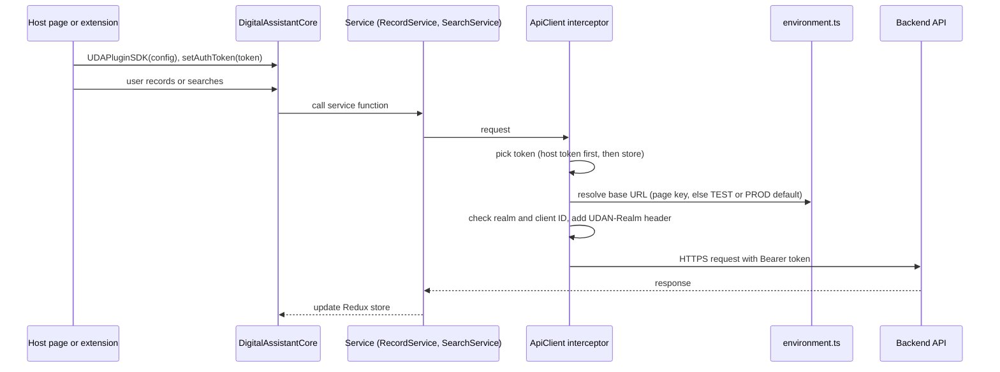

# Architecture overview

`@udan/digital-assistant-sdk` is one TypeScript package that runs in the browser. It records and replays user
actions on a page, keeps its state in one Redux store, and calls a Keycloak-protected backend. This page is the map;
[`AGENTS.md`](../../AGENTS.md) section 4 lists each folder's modules.

## Components

The repository declares one component: the root `package.json`. There is no workspace and no second app.

| Part | Path | What it does |
|---|---|---|
| Public surface | `src/index.ts` | Exports `DigitalAssistantCore`, configs, the store, slices, services and utils; sets the `UDA*` globals |
| Configuration | `src/config/` | `AppConfig`, `CustomConfig`, `environment.ts` (TEST or PROD URL resolver), constants, endpoints |
| Services | `src/services/` | `apiClient`, `hostAuthToken`, `AuthManager`, and the record, search, step-editing and translate services |
| State | `src/store/` | One Redux store with slices for flow, recording, editing, user, validation and notification |
| DOM engine and helpers | `src/util/` | Node matching (`util/node/`), playback, recording, storage, translation |
| Build | `webpack.config.js` | One config, `--env build=<local\|development\|production\|qa>`, output in `dist/` |

## Entry points

- `src/index.ts`: the source entry point and the public API.
- `package.json` `main`, `module`, `types` and `exports`: they point into `dist/`, which CI builds
  ([ADR 0004](../adr/0004-dist-built-in-ci.md)).
- Globals for script-tag hosts: `UDAPluginSDK`, `UDAGlobalConfig`, `UDAAuthConfig` and `UDAAuthDataConfig` on
  `globalThis` (`src/index.ts`). [`USAGE.md`](../../USAGE.md) shows a host page.

## Data stores

| Store | Where | Holds |
|---|---|---|
| Redux store | `src/store/` | Session, recording, flow and validation state; one instance for the whole SDK |
| Browser storage | `src/util/storage/StorageUtil.ts` | Persisted slice state: extension storage in the extension, `localStorage` in a web page |
| Host token | `src/services/hostAuthToken.ts` | The token from `setAuthToken`, in module state only, never persisted |
| Backend API | Remote, URL from `src/config/environment.ts` | Recordings, search, users and validation |

## A request, end to end

This sequence shows how one user action reaches the backend, and which code picks the token and the URL.

The token order and the SSO rules are in [ADR 0003](../adr/0003-authentication.md). The URL rules are in
[ADR 0001](../adr/0001-public-build-time-config.md).

## Repository notes

| Path | Note | Tag |
|---|---|---|
| `package-lock.json` (585 KB) | The only tracked file over 512 KB | By design: the npm lockfile |

The tracked tree has no binary files, no minified assets and no catch-all folder over 50 files
(`git ls-files`, 2026-11-11).
